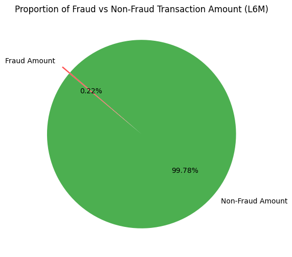
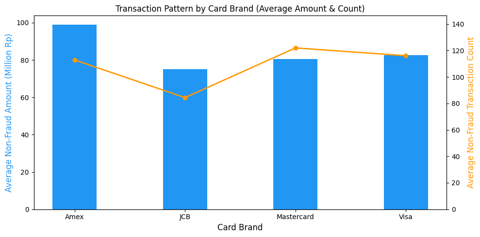
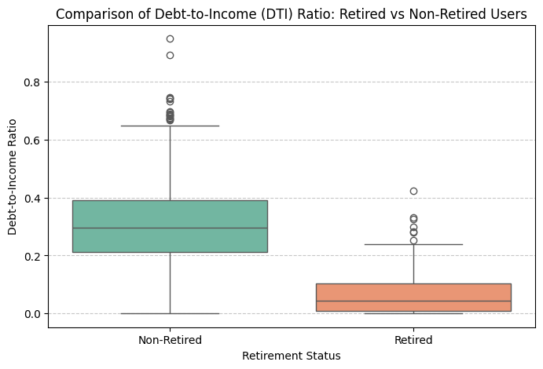
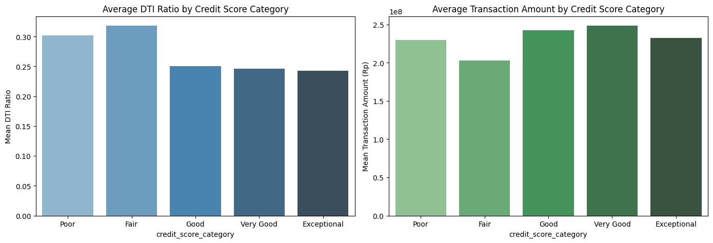
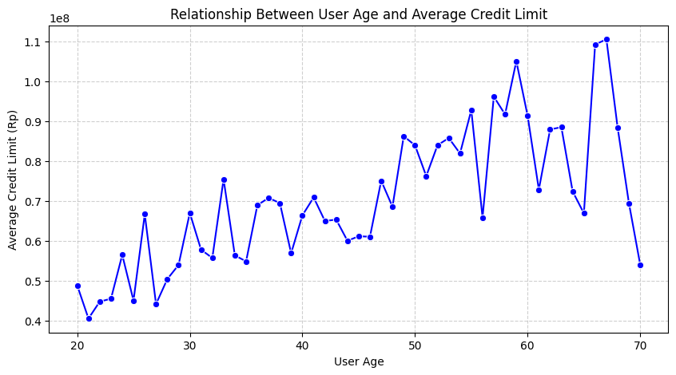
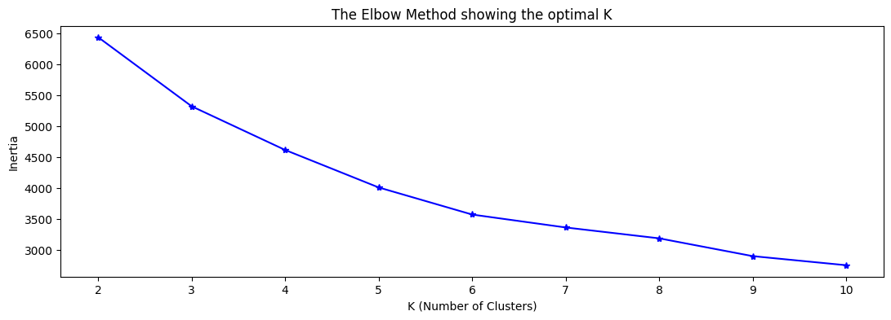
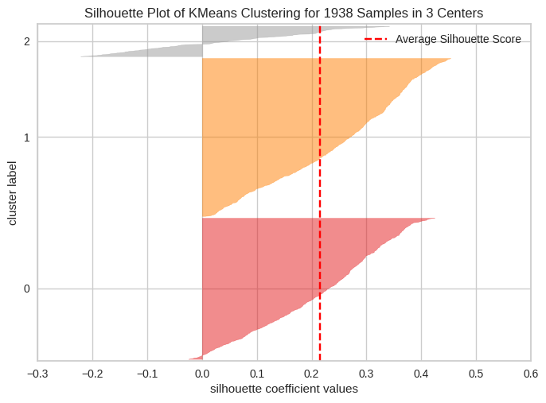

# RevoBank Credit Card Sales Performance (Python)

Credit card customer analysis for a fictional bank, covering **data cleaning, exploratory data analysis (EDA), and customer segmentation with K-Means clustering**, using **Python in Google Colab**.
Assignment of the **RevoU Full Stack Data Analytics (FSDA) program, 2026**.

**Author:** Johannes Krysosthomus Thedens Dominggu ([LinkedIn](https://www.linkedin.com/in/johannes-krysosthomus-thedens-dominggu/))

📓 **Notebook:** [RevoBank_Credit_Card_Analysis.ipynb](notebook/RevoBank_Credit_Card_Analysis.ipynb)<br>
📄 **Presentation:** [RevoBank_Credit_Card_Analysis.pdf](presentation/RevoBank_Credit_Card_Analysis.pdf)

---

## 📌 Project Overview

**Goal:** Analyze the behavior of existing credit card customers to find opportunities to **increase credit card transaction frequency**.

> **Disclaimer:** RevoBank is a fictional bank. The dataset was provided by RevoU for a class assignment and is **not included** in this repository. Outputs that showed card numbers and CVV values have been removed from the notebook.

## 🗂️ Dataset

| Table | Rows (raw) | Description |
|-------|-----------|-------------|
| `card` | 5,599 | Credit card data: brand, expiry date, credit limit, fraud and non-fraud transactions in the last 6 months (L6M) |
| `user` | 2,000 | Customer data: birthdate, retirement age, income, total debt, credit score |

Reference date for the analysis: **31 May 2025**.

## 🛠️ Tools

- **Python (Google Colab):** Pandas, NumPy, Matplotlib, Seaborn
- **Machine Learning:** Scikit-learn (K-Means, RobustScaler), Yellowbrick (Silhouette)

## 📁 Repository Structure

```
├── README.md
├── notebook/       # Full Google Colab notebook (cleaning, EDA, clustering)
├── images/         # Charts exported from the notebook
└── presentation/   # Final presentation (PDF)
```

## 🧹 Data Cleaning

**Card dataset (5,599 → 5,531 rows)**
- Converted data types: IDs to string, `expires` and `acct_open_date` to datetime, and money columns (stored as `"Rp53.189.000"`) to float
- Fixed typos in `card_brand` (e.g. `Jcb` → `JCB`, extra spaces in `Visa`)
- Filled missing values with 0 in `credit_limit` and the 4 transaction columns, so they can be filtered and aggregated
- Removed irrelevant columns: `card_number` and `cvv`
- Removed **31 duplicate IDs** (`id` is the primary key)
- Removed expired cards and cards with a credit limit of 0

**User dataset (2,000 rows)**
- Converted data types (birthdate, income, and debt columns)
- No missing values and no duplicates found
- Created new columns: `age`, `retired_flag`, and `DTI` (debt-to-income ratio = total debt / yearly income)

Both datasets were then aggregated per customer and **merged into 1,938 customers** for further analysis.

## 🔍 EDA & Key Insights

### 1. Net Profit & Fraud Rate
- Non-fraud transaction volume in the last 6 months: **Rp 456.06 billion**
- **Net profit: Rp 6.84 billion**, from a 1.5% MDR (merchant discount rate) fee on non-fraud transactions
- Fraud amount: Rp 1.01 billion, a **fraud rate of only 0.22%**



### 2. Transaction Behavior per Card Brand
- **Amex** has the highest average transaction amount per card (~Rp 99 million), a premium spending segment
- **Mastercard & Visa** drive transaction frequency (~116–122 transactions per card)
- **JCB** has the lowest activity in both frequency (~84 transactions) and amount (~Rp 75 million)



### 3. DTI Ratio: Retired vs Non-Retired
- Non-retired customers have a much higher median DTI (**0.30**) than retired customers (**0.04**)



### 4. DTI & Transactions by Credit Score
- **Fair** (31.8%) and **Poor** (30.2%) customers have the highest average DTI. Good to Exceptional customers stay stable at 24–25%
- **Very Good** customers have the highest average transaction amount (~Rp 248 million per 6 months), while **Fair** has the lowest (~Rp 203 million)



### 5. Age vs Credit Limit
- Average credit limit rises during productive age (20–50 years), then flattens or declines after 60



## 👥 Customer Segmentation (K-Means)

- **Features:** `yearly_income`, `total_debt`, `credit_score`, `credit_limit`, `dti_ratio`
- **Why K-Means instead of RFM:** K-Means can use more variables than RFM's 3, giving richer segments
- **Scaling:** RobustScaler, because the features contain many outliers
- **Choosing K:** Elbow Method and Silhouette Method → **K = 3** (silhouette score relatively stable compared to K ≥ 4)

| Elbow Method | Silhouette (K = 3) |
|---|---|
|  |  |

**Cluster profiles (median values):**

| Cluster | Label | Yearly Income | Total Debt | Credit Score | Credit Limit | DTI |
|---|---|---|---|---|---|---|
| 0 | Middle Income, High Debt (High Risk) | Rp 66.3M | Rp 24.5M | 683 | Rp 40.8M | 0.36 |
| 1 | Low Income, Low Debt, High Credit Score | Rp 57.5M | Rp 7.8M | 736 | Rp 63.9M | 0.15 |
| 2 | High Net Worth / Priority Customers | Rp 129.1M | Rp 33.9M | 727 | Rp 154.6M | 0.27 |

## ✅ Business Recommendations

| Segment / Area | Recommendation |
|---|---|
| **Cluster 0: High Risk** | Limit credit limit increases to prevent default. Offer debt consolidation or special-rate installment programs. |
| **Cluster 1: Low Risk, Conservative** | Offer credit limit increases, given their good credit history and low DTI. Give cashback or routine transaction promos to encourage card usage. |
| **Cluster 2: Priority Customers** | Offer premium/black cards, VIP lounge access, and lifestyle rewards (travel & dining), plus investment, insurance, or wealth management products. |
| **Fraud Prevention** | Strengthen rule-based and machine learning fraud detection, and require OTP/biometric authentication for high-value transactions. |
| **Card Brand** | Create spending-based loyalty rewards for Amex holders, and run cashback or merchant promos to boost JCB usage. |
| **Credit Score** | Apply credit limit capping and regular DTI reviews for Fair and Poor customers, and give promos to Good–Exceptional customers. |
| **Age** | Offer regular limit increases to productive-age customers (25–45) with good payment history, and senior-focused benefits to keep older customers' cards active. |

## 📝 Notes

- The notebook was run in Google Colab. Comments and insights inside the notebook are written in Indonesian.
- The dataset is not included because it belongs to RevoU's course material. The dataset links in the notebook have been replaced with placeholders.
